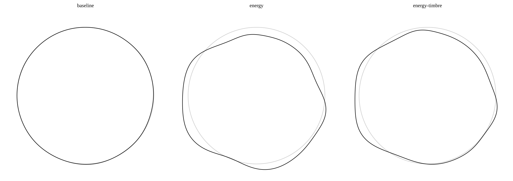

# Ripple: a spoken word, a personal curve

Ripple turns a recorded name or word into a rounded, **closed circular SVG**.
Several words can be overlapped on **the same nominal circle diameter and
center**, rather than fitted individually or arranged in a grid. This is an
artistic keepsake of an utterance, **not a unique biometric signature**.
Beauty, recognizability and tattoo suitability require human judgment.

## Setup

Python **3.11+** (standard-library TOML), NumPy and svgpathtools:

```bash
python3 -m venv .venv
source .venv/bin/activate
python3 -m pip install -r requirements.txt
python3 main.py --help
python3 compare.py --help
```

CairoSVG is included for optional PNG export in `merge.py`; it also needs
native Cairo. Missing Python/native Cairo produces an explicit warning when
PNG export is implicit. An explicit `--png` request fails if it cannot render.
SVG generation does not need Cairo. Use `--no-png` for SVG-only merging.

## One recording

```bash
mkdir -p artwork
python3 main.py samples/HelloWorld.wav artwork/hello.svg --algorithm energy
python3 main.py samples/HelloWorld.wav artwork/baseline.svg \
  --algorithm baseline --smoothness 0 --poly-degree 4 --circle
```

Only uncompressed **16-bit PCM WAV** is accepted. All channels are averaged
in floating point. All methods remove DC, trim surrounding silence
conservatively and normalize peak gain. Internal pauses and relative timing
are retained. Shared preprocessing intentionally changes old baseline images.
Empty, silent, DC-only, truncated and insufficient inputs fail explicitly.

| Algorithm | What shapes the curve |
|---|---|
| `baseline` (default) | Cyclic median of the signed waveform, extrema and legacy recursive midpoints; Fourier or polynomial fit |
| `energy` | Short-time RMS, power-law dynamic-range compression, normalized utterance time |
| `energy-timbre` | Energy plus weighted **relative spectral-band energies**, energy-gated to avoid decorating silence |
| `energy-pitch` | Energy plus **externally supplied known ground truth**: absolute log-frequency in a broad harmonic and relative inflection in time-varying detail |

No pitch is ever detected or estimated. Natural-speech recordings generally
cannot supply exact ground truth; the existing speech samples demonstrate only
the first three methods. Read the [pitch input guide](docs/pitch-input.md)
before using `--algorithm energy-pitch --pitch FILE.pitch.json`.

The artwork is always circular. `--circle` **adds** a light-gray nominal reference
circle; it does not replace the word. `--no-circle` overrides configuration.
The output is square with side `min(max_width, height)`, independent of audio
duration. Default width/height are **16384 / 2048**; default nominal diameter is
80% of that square's side, with up to 18% radial deformation about the nominal
radius. Stroke width is in SVG user units. These are scalable exports, not
fixed physical tattoo dimensions or a claim of tattoo readiness.

Each conversion writes `OUTPUT_STEM.diagnostic.svg` beside the artwork,
or the path specified with `--diagnostic`. It no longer writes shared
`tmp.svg`: parallel conversions with distinct output stems are isolated.
Parent directories must exist. Diagnostics contain the processed waveform,
baseline envelopes or energy/band features, and the pre-periodic fitted profile.
The baseline diagnostic profile is shown before its rendering gain.

## Configuration and artistic controls

All defaults live in versioned [`ripple.toml`](ripple.toml), beside the scripts.
Precedence is **project defaults -> explicitly selected `--config` -> CLI**.
No configuration is discovered in the working directory. An override may
contain a subset of settings but must declare `version = 1`; unknown settings,
wrong types, nonfinite values and unsupported combinations fail.

```toml
version = 1
[render]
algorithm = "energy-timbre"
height = 1024
color = "black"
stroke_width = 2.0
detail = 12
roundness = 0.8
deformation = 0.12
```

```bash
python3 main.py samples/HelloWorld.wav artwork/custom.svg --config custom.toml --color navy
```

`--poly-degree` (alias `--detail`) controls harmonic count or baseline
polynomial degree. **Detail is separate from deformation and roundness**:
`--deformation 0` gives a circle; `--roundness` attenuates high harmonics.
`render.points` controls cubic approximation density (at least eight per
harmonic). Profiles are bounded without stretching tiny residuals to full
deformation. The limiter checks angular samples with a conservative derivative
margin, so harmonics are not unnecessarily reduced as if all their peaks aligned.
Analytic periodic derivatives give connected, matching tangents,
including the seam. Coordinates stay floating point and export dimensions do
not influence extraction.

`--fitting poly` is **baseline-only**; its fitted profile is projected to
periodic Fourier geometry for a clean circular seam. Polynomial degree needs
more distinct midpoints than the requested degree; Fourier baseline requires
at least four and caps terms to available evidence. `--smoothness` controls
only baseline's cyclic signed-waveform median, using the legacy perceptual
scaling. New methods use millisecond windows and `roundness`, not this median.

`--baseline-gain` (`render.baseline_gain`, default **16**, range 0 to 64) gives
the much smaller signed-midpoint profile a fixed display gain before the common
geometry limiter. Both baseline fits use it. It does not change extraction,
normalize each recording to full contrast, or affect the energy methods.
Use **1** for the previous unscaled baseline or **0** for a nominal circle.
Tiny residuals stay tiny, but the gain can also emphasize recording artifacts;
it is an artistic contrast control, not evidence of additional voice information.

The `[preprocess]` table controls relative trim threshold, padding and peak
normalization. A bare recording without leading/trailing room cannot retain
the same padding as a recording with surrounding silence; small border
differences can remain. `[features]` controls RMS window/hop milliseconds,
compression, weights and band edges. RMS uses rectangular zero-padded
windows; bands use Hann-windowed FFT power, normalized by total band power.
Edges must cover the WAV Nyquist frequency; frequencies above Nyquist simply
have no power. Positive/negative band weights encode an explicit artistic
choice, not a learned identity model. Pitch reference/octave scale are global,
not normalized per word. Zero secondary weight produces energy-only geometry
(pitch still must be valid if its algorithm is selected). See the TOML for
all values. Style overrides include `--max-width`, `--height`, `--color`,
`--stroke-width`, `--circle`; preprocessing and feature weights use TOML.

## Compare and compose multiple words

### Hello World example

The [Hello World comparison](output_samples/hello-world-comparison/comparison.svg)
shows the same recording with baseline, energy, and energy-timbre, left to right.
All three use the same nominal diameter and center within their panels.
The light-gray reference circle shows that nominal radius; the black curve
shows the recording's inward and outward deviations.
Energy-pitch is omitted because this natural-speech sample has no ground-truth
pitch sidecar.



This uses the explicit [expressive preset](presets/expressive.toml), not the
subtle project defaults. It reduces high-harmonic smoothing and increases
deformation and feature weights, without normalizing each curve to fill its
radial range. The same preset can be used for other recordings; it does not
guarantee visible differences for every input. Baseline uses the default fixed
16x display gain so its signed-midpoint variation is visible without per-word
min-max normalization.

To reproduce it, use a new output directory:

```bash
python3 compare.py samples/HelloWorld.wav \
  --algorithms baseline energy energy-timbre \
  --output-dir artwork/hello-world-comparison \
  --config presets/expressive.toml --circle
```

Individual curves, overlays, and diagnostics are in
[`output_samples/hello-world-comparison/`](output_samples/hello-world-comparison/).

### Your recordings

Use an explicit **new** output directory. With real recordings and no ground
truth, explicitly select the first three methods:

```bash
python3 compare.py samples/HelloWorld.wav samples/Kuba.wav \
  --algorithms baseline energy energy-timbre --output-dir artwork/comparison \
  --color black --height 1024
```

Output includes:

- `comparison.svg`: labeled side-by-side **algorithm panels**, each containing
  the actual overlapped multiword composition.
- `METHOD/overlay.svg`: standalone tattoo composition, every word co-centered
  on the **same nominal diameter**, without per-word bounding-box fitting,
  translation, scaling or duration-dependent size.
- `METHOD/words/`: collision-safe numbered individual SVGs, including repeated
  file stems/paths; `METHOD/diagnostics/`: isolated diagnostic SVGs.

All words use identical preprocessing settings and styling. Overlay overlap
is intentional. Word labels are in SVG group titles; algorithm labels are in
the preview. Default comparison includes all four methods and therefore
requires **one valid `--pitch` JSON per WAV**, in the same order. Missing or
invalid inputs are checked/rendered before any comparison files are written;
pitch is never silently replaced by energy.

```bash
python3 generate_fixtures.py /tmp/ripple-known-controls
python3 compare.py /tmp/ripple-known-controls/constant.wav \
  /tmp/ripple-known-controls/changing.wav /tmp/ripple-known-controls/interrupted.wav \
  --pitch /tmp/ripple-known-controls/constant.pitch.json \
  /tmp/ripple-known-controls/changing.pitch.json /tmp/ripple-known-controls/interrupted.pitch.json \
  --output-dir artwork/four-methods --color black
```

The deterministic generator creates controlled oscillator WAVs and records
their actual generating frequencies, including explicitly unvoiced silence.
It refuses to overwrite an existing directory. These are **synthetic controls**,
not speech examples or pitch estimates.

`bash names.sh NEW_OUTPUT_DIR [OPTIONS]` compares/overlaps the four example names
using the first three methods; it no longer overwrites `output_names/`.

## Merge existing SVGs

```bash
python3 merge.py artwork/comparison/energy/words \
  --width 1024 --height 1024 --output artwork/merged.svg --no-png
# With working CairoSVG + native Cairo:
python3 merge.py artwork/comparison/energy/words \
  --width 1024 --height 1024 --output artwork/merged.svg --png artwork/merged.png
```

This overlays all `.svg` **path geometry** in a directory (not a collage).
`--output` is required: there is no implicit destination that could overwrite
the committed examples. Keep output outside the input directory and merge `words/`, not diagnostics or
the labeled preview. Geometry scales from each source canvas origin, not its
individual bounding box; `--thickness` sets the merged stroke. Nonsquare merge
dimensions intentionally make an ellipse. For a common circle, use square
dimensions and identically configured inputs. General transformed SVG groups
are not supported by this legacy path-only merger.

## Validation and human evaluation

```bash
python3 -m py_compile main.py ripple.py utils.py merge.py config.py audio.py pitch.py features.py geometry.py compare.py generate_fixtures.py
python3 -m unittest discover -s tests -v
```

Standard-library unittest uses small deterministic 16-bit fixtures, explicit
SVG/curve assertions and isolated temporary directories. CI runs Python 3.11
and 3.13. Native PNG availability/failure is checked explicitly; a missing PNG
is not reported as a successful render. Tests do not regenerate committed
examples. See [comparison and evaluation](docs/evaluation.md) for a blinded
human protocol. Synthetic invariances cannot establish real-world uniqueness,
speaker identity or beauty.

## License

[MIT](LICENSE).
