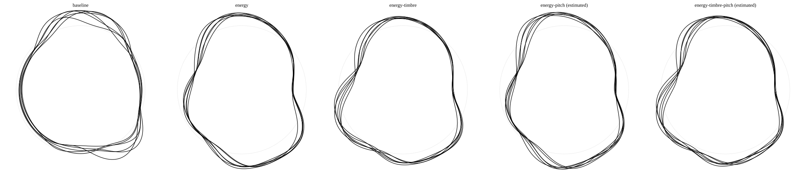
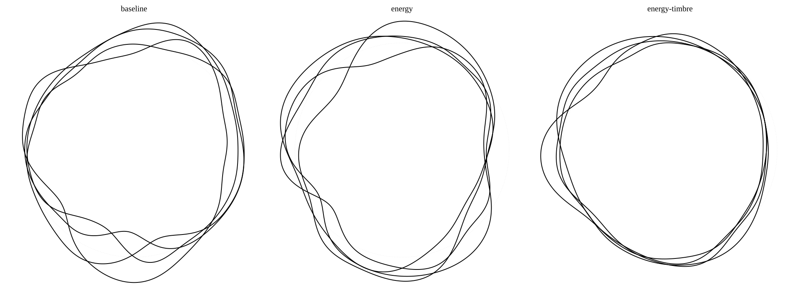

# Ripple: a spoken word, a personal curve

Ripple turns a recorded name or word into a rounded, **closed circular SVG**.
Several words can be overlapped on **the same nominal circle diameter and
center**, rather than fitted individually or arranged in a grid. This is an
artistic keepsake of an utterance, **not a unique biometric signature**.
Beauty, recognizability and tattoo suitability require human judgment.

## Setup

Python **3.11+** (standard-library TOML), NumPy, svgpathtools and Praat-Parselmouth:

Python source lives in `src/`. Run the following commands from the repository
root; configuration, samples, tests, and the `names.sh` helper remain there.

```bash
python3 -m venv .venv
source .venv/bin/activate
python3 -m pip install -r requirements.txt
python3 src/main.py --help
python3 src/compare.py --help
```

CairoSVG is included for optional PNG export in `src/merge.py`; it also needs
native Cairo. Missing Python/native Cairo produces an explicit warning when
PNG export is implicit. An explicit `--png` request fails if it cannot render.
SVG generation does not need Cairo. Use `--no-png` for SVG-only merging.

`praat-parselmouth` embeds Praat's pitch analysis in Python. Installing the
requirements is sufficient: no Praat desktop application, account, model
download or manual pitch annotation is needed. Audio processing stays local.

Have a microphone? Start with the [simple recording and pitch guide](docs/recording-guide.md):
record/export a WAV in Audacity, then compare all five methods automatically.

## One recording

```bash
mkdir -p artwork
python3 src/main.py samples/HelloWorld.wav artwork/hello.svg --algorithm energy
python3 src/main.py samples/HelloWorld.wav artwork/pitch.svg --algorithm energy-pitch
python3 src/main.py samples/HelloWorld.wav artwork/combined.svg --algorithm energy-timbre-pitch
python3 src/main.py samples/HelloWorld.wav artwork/baseline.svg \
  --algorithm baseline --smoothness 0 --poly-degree 4 --circle
```

Only uncompressed **16-bit PCM WAV** is accepted. All channels are averaged
in floating point. All methods remove DC, use sustained RMS activity to trim
surrounding silence and detached low-level noise, and normalize peak gain.
Internal pauses and relative timing are retained. Shared preprocessing
intentionally changes older images. Empty, silent, DC-only, truncated and
insufficient inputs fail explicitly, as do recordings with no sustained activity.

| Algorithm | What shapes the curve |
|---|---|
| `baseline` (default) | Cyclic median of the signed waveform, extrema and legacy recursive midpoints; Fourier or polynomial fit |
| `energy` | Short-time RMS, power-law dynamic-range compression, normalized utterance time |
| `energy-timbre` | Energy plus the **spectral-band variation not explained by the energy contour**, without amplifying the residual |
| `energy-pitch` | Energy plus **automatically estimated pitch**, or supplied known ground truth: absolute log-frequency in a broad harmonic and relative inflection in time-varying detail |
| `energy-timbre-pitch` | Energy plus **both relative timbre and pitch**, combined before the shared periodic fit using the existing feature weights |

Both pitch-based methods estimate pitch directly from the WAV using Praat autocorrelation.
Estimates are not ground truth and can contain octave/voicing errors. CLI output,
SVG provenance metadata and comparison panel labels distinguish estimated from
known pitch. An optional `--pitch FILE.pitch.json` uses validated known-source
data instead; an invalid supplied file fails rather than falling back to
estimation. Read the [pitch guide](docs/pitch-input.md) for settings and limitations.

The artwork is always circular. A faint light-gray (`#e0e0e0`), 1 px dotted
nominal reference circle is enabled by default beneath the artwork; it does
not replace the word. Its thickness is independent of the artwork stroke.
`--no-circle` hides it, and `--circle` restores it when overriding configuration.
The output is square with side `min(max_width, height)`, independent of audio
duration. Default width/height are **16384 / 1024**; default nominal diameter is
80% of that square's side, with up to 24% radial deformation about the nominal
radius. Curves default to black with a stroke width of 3 SVG user units.
Very small canvases need a thinner stroke to retain the full deformation
margin, for example `--height 256 --stroke-width 1`. These are scalable exports, not
fixed physical tattoo dimensions or a claim of tattoo readiness.

Each conversion writes `OUTPUT_STEM.diagnostic.svg` beside the artwork,
or the path specified with `--diagnostic`. It no longer writes shared
`tmp.svg`: parallel conversions with distinct output stems are isolated.
Parent directories must exist. Diagnostics contain the processed waveform,
baseline envelopes or energy/band features, and the pre-periodic fitted profile.
The baseline diagnostic profile is shown before its rendering gain.
For `energy-pitch`, the blue diagnostic curve is pitch modulation (not raw Hz);
the red curve is energy. For `energy-timbre-pitch`, red is energy, blue is timbre,
and green is pitch modulation. Timbre methods show the corrected, unweighted
timbre residual in blue by default. Both SVGs retain pitch provenance and estimator versions.
Diagnostics also record `data-trim-method`, `data-trim-start` and `data-trim-end`;
the bounds are original WAV sample-frame indices, with an exclusive end.

## Configuration and artistic controls

All defaults live in versioned [`ripple.toml`](ripple.toml) at the repository root.
Precedence is **project defaults -> explicitly selected `--config` -> CLI**.
No configuration is discovered in the working directory. An override may
contain a subset of settings but must declare `version = 1`; unknown settings,
wrong types, nonfinite values and unsupported combinations fail.

```toml
version = 1
[render]
algorithm = "energy-timbre"
height = 1024
color = "black"
stroke_width = 2.0
detail = 12
roundness = 0.8
deformation = 0.12
```

```bash
python3 src/main.py samples/HelloWorld.wav artwork/custom.svg --config custom.toml --color navy
```

`--poly-degree` (alias `--detail`) controls harmonic count or baseline
polynomial degree. **Detail is separate from deformation and roundness**:
`--deformation 0` gives a circle; `--roundness` attenuates high harmonics.
`render.points` controls cubic approximation density (at least eight per
harmonic). Profiles are bounded without stretching tiny residuals to full
deformation. The limiter checks angular samples with a conservative derivative
margin, so harmonics are not unnecessarily reduced as if all their peaks aligned.
Analytic periodic derivatives give connected, matching tangents,
including the seam. Coordinates stay floating point and export dimensions do
not influence extraction.

`--fitting poly` is **baseline-only**; its fitted profile is projected to
periodic Fourier geometry for a clean circular seam. Polynomial degree needs
more distinct midpoints than the requested degree; Fourier baseline requires
at least four and caps terms to available evidence. `--smoothness` controls
only baseline's cyclic signed-waveform median, using the legacy perceptual
scaling. New methods use millisecond windows and `roundness`, not this median.

`--baseline-gain` (`render.baseline_gain`, default **19.2**, range 0 to 64) gives
the much smaller signed-midpoint profile a fixed display gain before the common
geometry limiter. Both baseline fits use it. It does not change extraction,
normalize each recording to full contrast, or affect the energy methods.
Use **1** for the previous unscaled baseline or **0** for a nominal circle.
Tiny residuals stay tiny, but the gain can also emphasize recording artifacts;
it is an artistic contrast control, not evidence of additional voice information.

The `[preprocess]` table controls trimming and peak normalization:

- `trim_method = "rms"` (default): 20 ms RMS windows at 5 ms hops, including the
  final window. Sustained runs at `trim_trigger_db = -20` relative to maximum
  RMS anchor the first and last active regions. A run needs at least 30 ms of
  hops (six frames at 48 kHz); shorter clips require all available frames.
- Boundaries extend through quieter activity at `trim_db = -30`, stopping after
  40 ms of consecutive below-threshold frames. All gaps **between** the first
  and last sustained regions remain intact. `trim_padding_ms = 20` adds context
  beyond the retained windows to protect quiet onsets and releases.
- This is an energy-based boundary heuristic, **not speech recognition or
  denoising**. It does not use pitch voicing to cut words. Loud sustained noise
  may remain, and very quiet detached consonants may be missed. Review difficult
  recordings rather than assuming that the detected interval is exact speech.

Peak normalization remains unchanged: `normalize_peak = 0.9` uses the original
DC-removed recording's peak, not per-curve min-max scaling. Use
[`presets/legacy-trim.toml`](presets/legacy-trim.toml) with `--config` to reproduce
the previous sample-peak detector (`trim_method = "peak"`, `trim_db = -40`,
10 ms padding). In peak mode, `trim_trigger_db` is unused. A custom RMS
`trim_db` must be no higher than `trim_trigger_db`.

A bare recording without leading/trailing room cannot retain the same padding
as a recording with surrounding silence; small border differences can remain,
including trim-window hop alignment. `[features]` controls RMS window/hop milliseconds,
compression, weights and band edges. RMS uses rectangular zero-padded
windows; bands use Hann-windowed FFT power, normalized by total band power.
Edges must cover the WAV Nyquist frequency; frequencies above Nyquist simply
have no power. Positive/negative band weights encode an explicit artistic
choice, not a learned identity model. Pitch reference and sensitivity scales are
global, not normalized per word. Zeroing all active secondary weights produces energy-only
geometry (pitch still must be valid if its algorithm is selected). See the TOML for
all values. Style overrides include `--max-width`, `--height`, `--color`,
`--stroke-width`, `--circle`; preprocessing and most feature controls use TOML.

**Timbre no longer acts as an accidental roundness control.** With
`features.timbre_mode = "residual"`, the energy-gated spectral-band signal loses
its mean and its least-squares component along the centered energy contour,
on the common normalized-time grid. This removes the energy-shaped contribution
that low-frequency recordings previously used to cancel the energy deformation.
The remaining spectral variation is added at its original magnitude, weighted
by `timbre_weight`; it is not stretched to fill the available radial range.
Constant spectral balance alone no longer changes energy contrast. This describes
within-word spectral variation, not a separate encoding of average spectral color.
The shared Fourier smoothing and amplitude bound still apply, so the final curve
is not guaranteed to have more deviation at every angle or under every setting.

**Pitch has two sensitivity scales and a stronger default.** Average voice pitch
still contributes a broad bend; small rises/falls within a word now have their own,
narrower response scale. Adjust overall strength in either CLI:

```bash
python3 src/main.py samples/HelloWorld.wav artwork/pitch.svg \
  --algorithm energy-pitch --pitch-sensitivity 2
python3 src/compare.py samples/HelloWorld.wav \
  --output-dir artwork/pitch-comparison --pitch-sensitivity 2
```

`--pitch-sensitivity` overrides `features.pitch_weight` (default **1.35**, range
0 to 4). It changes the drawing, **not Praat's pitch detection**. Zero removes
pitch's geometric contribution but still requires valid pitch. It affects both
pitch-based methods and leaves baseline and energy-only curves unchanged.
The advanced `[features]` controls are:

| Setting | Default | Meaning |
|---|---|---|
| `pitch_octaves` | `2.0` | Response scale for average log-pitch relative to `pitch_reference_hz` |
| `pitch_inflection_octaves` | `0.5` | Separate response scale for log-pitch changes around the word's voiced mean |
| `pitch_absolute_weight` | `0.6` | Broad average-pitch contribution |
| `pitch_inflection_weight` | `0.4` | Within-word inflection contribution |

Smaller octave scales are more sensitive; both accept 0.1 to 8 octaves.
These are fixed global scales, not per-recording pitch-range normalization.
More sensitivity also makes estimation errors more visible, and the shared
geometry bound can limit the resulting change. Previously `pitch_octaves`
controlled both components; it now controls only the average-pitch component.
[`presets/legacy-features.toml`](presets/legacy-features.toml) restores the previous
timbre mapping and pitch response/strength while keeping the improved trimming.

`energy-timbre-pitch` adds the same energy, timbre and pitch contributions used
by the simpler methods before Fourier fitting and bounding; it does not merge
their rendered curves. It uses `energy_weight`, `timbre_weight` and `pitch_weight`
without additional scaling. Zero timbre weight matches `energy-pitch`; zero
pitch weight matches `energy-timbre`; zeroing both matches `energy`.

`[pitch_estimation]` controls the automatic search range (`floor_hz = 60.0`,
`ceiling_hz = 600.0`), time step (`hop_ms = 10.0`) and Praat voicing threshold
(`voicing_threshold = 0.45`). These defaults need no user input for ordinary
voice recordings. Extreme registers or difficult recordings may need adjustment.
The accurate autocorrelation window needs at least `6 / floor_hz` seconds after
trimming (100 ms by default). No voiced estimate, a missing dependency or an
analysis error fails explicitly, even with zero pitch weight.

## Compare and compose multiple words

### Hello World example

The [Hello World comparison](output_samples/hello-world-comparison/comparison.svg)
shows baseline, energy, energy-timbre, energy-pitch, and energy-timbre-pitch,
left to right. All five use the same nominal diameter and center within their panels.
The light-gray reference circle shows that nominal radius; the black curve
shows the recording's inward and outward deviations.
The last two panels use automatic Praat pitch estimation and are labeled
**estimated**; they do not claim known ground truth.


This uses the **project defaults**, including the stronger contour settings and
gray reference circles. The optional [expressive preset](presets/expressive.toml)
retains the same style overrides for existing commands. These settings reduce
high-harmonic smoothing and increase deformation and feature weights, without
normalizing each curve to fill its radial range. They do not guarantee visible
differences for every input. Baseline uses a fixed
19.2x display gain so its signed-midpoint variation is visible without per-word
min-max normalization.

To reproduce it, use a new output directory:

```bash
python3 src/compare.py samples/HelloWorld.wav \
  --output-dir artwork/hello-world-comparison
```

Individual curves, overlays, and diagnostics are in
[`output_samples/hello-world-comparison/`](output_samples/hello-world-comparison/).

### All sample comparisons

Every WAV in `samples/` has a comparison using the project defaults. Each
preview shows baseline, energy, energy-timbre, energy-pitch, and energy-timbre-pitch,
with a faint dotted reference circle beneath the artwork. Pitch is estimated
directly from each WAV, without sidecars.

| Recording | Comparison |
|---|---|
| `A4_1s.wav` | [View](output_samples/a4-1s-comparison/comparison.svg) |
| `Baltazar.wav` | [View](output_samples/baltazar-comparison/comparison.svg) |
| `Eliska.wav` | [View](output_samples/eliska-comparison/comparison.svg) |
| `Eliska (1).wav` through `Eliska (6).wav` | [View all six](output_samples/eliska-recordings-comparison/comparison.svg) |
| `HelloWorld.wav` | [View](output_samples/hello-world-comparison/comparison.svg) |
| `Kuba.wav` | [View](output_samples/kuba-comparison/comparison.svg) |
| `Leontynka.wav` | [View](output_samples/leontynka-comparison/comparison.svg) |

Each comparison directory also contains individual curves, overlays, and
diagnostics for all five methods.

### Six Eliska recordings

The [Eliska recordings comparison](output_samples/eliska-recordings-comparison/comparison.svg)
overlays all six recordings from [the uploaded set](https://github.com/JakubMifek/ripple/commit/c86aa151c9db46e1926b60a9351a530075d19a8f),
in numeric order, in each of the five algorithm panels. Each recording shares
the same nominal diameter and center, with one faint dotted reference beneath
all six black curves. Pitch is estimated automatically for the last two styles.



```bash
python3 src/compare.py "samples/Eliska (1).wav" "samples/Eliska (2).wav" \
  "samples/Eliska (3).wav" "samples/Eliska (4).wav" \
  "samples/Eliska (5).wav" "samples/Eliska (6).wav" \
  --output-dir artwork/eliska-recordings-comparison
```

Individual recording curves and diagnostics are included under each algorithm
in the [comparison directory](output_samples/eliska-recordings-comparison/).

The gallery uses the improved RMS trimming. Waveform/RMS and spectral inspection
found detached low-frequency edge bursts that the previous sample threshold
retained. The new retained intervals are:

| Take | Previous interval (s) | RMS interval (s) |
|---|---|---|
| 1 | 0.193-1.510 | 0.360-1.045 |
| 2 | 0.482-1.510 | 0.470-1.105 |
| 3 | 0.402-1.440 | 0.395-1.015 |
| 4 | 0.220-1.260 | 0.210-0.840 |
| 5 | 0.175-0.988 | 0.170-0.780 |
| 6 | 0.297-1.460 | 0.285-0.915 |

This removes about 0.20-0.63 s of net edge context per take without changing
their retained peaks. The trimming improvement is in the time span mapped
around the circle, not a new gain rule; the galleries also use the residual
timbre and two-scale pitch defaults described above. These are measured
automatic crop boundaries, not manually confirmed phonetic labels. The original
WAVs are untouched. Add `--config presets/legacy-trim.toml` and choose a new
output directory to compare against the previous trimming.

### Combined names example

The [combined comparison](output_samples/names-comparison/comparison.svg)
overlays **Kuba, Eliska, Baltazar, and Leontynka**, in that order. Each algorithm
panel shares one nominal diameter and center across all four words, with a
single dotted reference circle in the lowest layer beneath every black curve.
The last two panels use automatically estimated pitch for each name.



```bash
python3 src/compare.py samples/Kuba.wav samples/Eliska.wav \
  samples/Baltazar.wav samples/Leontynka.wav \
  --output-dir artwork/names-comparison
```

Standalone compositions:
[baseline](output_samples/names-comparison/baseline/overlay.svg),
[energy](output_samples/names-comparison/energy/overlay.svg),
[energy-timbre](output_samples/names-comparison/energy-timbre/overlay.svg),
[energy-pitch (estimated)](output_samples/names-comparison/energy-pitch/overlay.svg),
[energy-timbre-pitch (estimated)](output_samples/names-comparison/energy-timbre-pitch/overlay.svg).

### Your recordings

Use an explicit **new** output directory. A WAV is the only data input needed
for all five methods, including automatic pitch estimation:

```bash
python3 src/compare.py samples/HelloWorld.wav samples/Kuba.wav \
  --output-dir artwork/comparison --color black --height 1024
```

Output includes:

- `comparison.svg`: labeled side-by-side **algorithm panels**, each containing
  the actual overlapped multiword composition.
- `METHOD/overlay.svg`: standalone tattoo composition, every word co-centered
  on the **same nominal diameter**, without per-word bounding-box fitting,
  translation, scaling or duration-dependent size.
- `METHOD/words/`: collision-safe numbered individual SVGs, including repeated
  file stems/paths; `METHOD/diagnostics/`: isolated diagnostic SVGs.

All words use identical preprocessing settings and styling. Overlay overlap
is intentional. Identical reference circles are drawn only once, behind all
word curves, including when merging individual word SVGs with `src/merge.py`.
Word labels are in SVG group titles; algorithm labels are in
the preview. Default comparison includes all five methods and estimates pitch
automatically. To override estimation, supply **one valid known-source `--pitch`
JSON per WAV**, in the same order. Missing/invalid inputs and estimation failures
are checked before any comparison files are written; pitch is never silently
replaced by energy. To deliberately skip pitch, select
`--algorithms baseline energy energy-timbre`.

```bash
python3 src/generate_fixtures.py /tmp/ripple-known-controls
python3 src/compare.py /tmp/ripple-known-controls/constant.wav \
  /tmp/ripple-known-controls/changing.wav /tmp/ripple-known-controls/interrupted.wav \
  --pitch /tmp/ripple-known-controls/constant.pitch.json \
  /tmp/ripple-known-controls/changing.pitch.json /tmp/ripple-known-controls/interrupted.pitch.json \
  --output-dir artwork/five-methods --color black
```

The deterministic generator creates controlled oscillator WAVs and records
their actual generating frequencies, including explicitly unvoiced silence.
It refuses to overwrite an existing directory. These are **synthetic controls**,
not speech examples or pitch estimates.

`bash names.sh NEW_OUTPUT_DIR [OPTIONS]` compares/overlaps the four example names
using all five methods with automatic pitch estimation; it does not overwrite
`output_names/`.

## Merge existing SVGs

```bash
python3 src/merge.py artwork/comparison/energy/words \
  --width 1024 --height 1024 --output artwork/merged.svg --no-png
# With working CairoSVG + native Cairo:
python3 src/merge.py artwork/comparison/energy/words \
  --width 1024 --height 1024 --output artwork/merged.svg --png artwork/merged.png
```

This overlays all `.svg` **path geometry** in a directory (not a collage).
`--output` is required: there is no implicit destination that could overwrite
the committed examples. Keep output outside the input directory and merge `words/`, not diagnostics or
the labeled preview. Geometry scales from each source canvas origin, not its
individual bounding box; `--thickness` sets the merged stroke. Nonsquare merge
dimensions intentionally make an ellipse. For a common circle, use square
dimensions and identically configured inputs. General transformed SVG groups
are not supported by this legacy path-only merger.

## Validation and human evaluation

```bash
python3 -m py_compile src/*.py
python3 -m unittest discover -s tests -v
```

Standard-library unittest uses small deterministic 16-bit fixtures, explicit
SVG/curve assertions and isolated temporary directories. CI runs Python 3.11
and 3.13. Native PNG availability/failure is checked explicitly; a missing PNG
is not reported as a successful render. Tests do not regenerate committed
examples. See [comparison and evaluation](docs/evaluation.md) for a blinded
human protocol. Synthetic invariances cannot establish real-world uniqueness,
speaker identity or beauty.

## License

[MIT](LICENSE).
